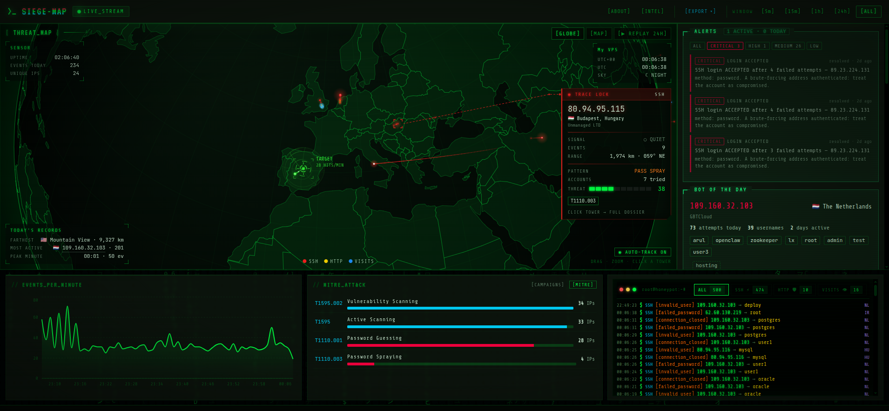
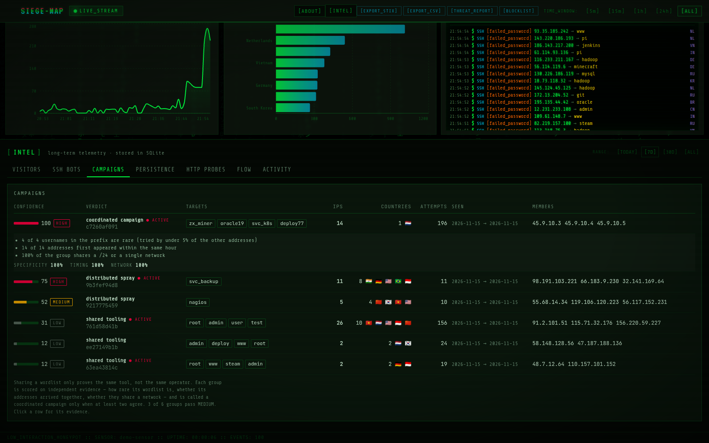
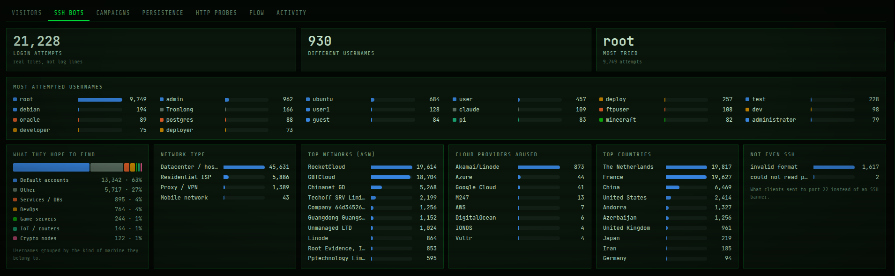
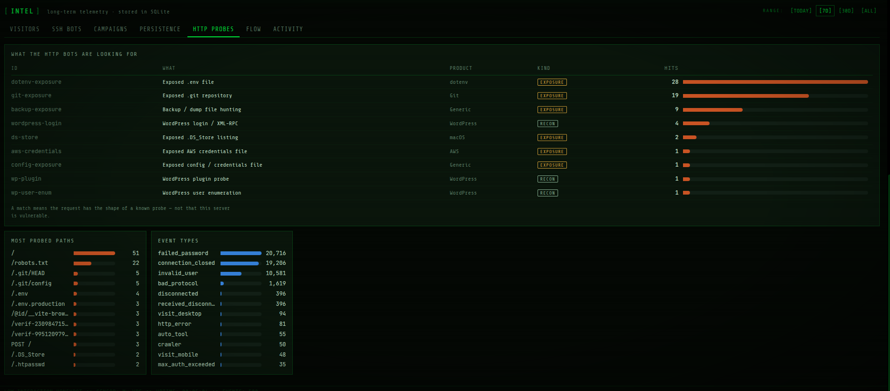
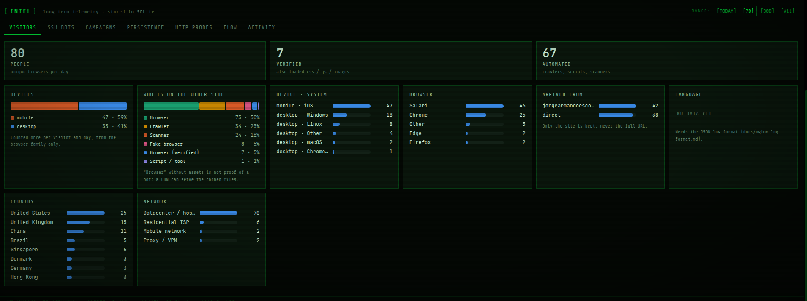

# siege map

**Visualizador de ataques SSH/HTTP en tiempo real .**
Lee logs de SSH y Nginx, geolocaliza las IPs, las clasifica con MITRE ATT&CK y las pinta en un mapa mundial con arcos animados, particulas de datos y un dashboard estilo terminal retro-futurista.

Pensado para correr en cualquier VPS con un solo `docker compose up`.


---

## Que hace exactamente

### En el mapa (panel principal)
Mapa Leaflet oscuro con **arcos animados** desde cada origen hasta tu VPS y **particulas de datos** viajando por ellos. Cada IP es un **punto pulsante** del color de su ataque (rojo SSH, amarillo HTTP, azul visitas reales). Click en una torre abre un **callout estilo espia** con el dossier resumido; otro click, el drawer completo. Vista de globo o mapa plano.


En modo mapa plano, al hacer click en una torre aparece el callout con el dossier resumido:



### Sidebar en vivo
Stats con tema Pip-Boy (scanlines CRT, fuente VT323, glitch ocasional): alertas por severidad, patrones de ataque (`PASSWORD_GUESSING`, `PASSWORD_SPRAYING`, `DICTIONARY_ATTACK`, `SSH_SCANNING`, `WEB_SCANNING`), top de paises, IPs por tipo, usuarios SSH probados y rutas HTTP separadas en bots vs. reales.

### Drawer de perfil de atacante
Click en cualquier IP abre el `THREAT DOSSIER`: identificacion (geo, ASN, links a Shodan y AbuseIPDB), threat assessment con el **score explicable** y su desglose, clasificacion de patron, badges **MITRE ATT&CK** y la **narrativa del ataque** (cuándo contactó, qué probó, a qué ritmo, veredicto).


### Feed en vivo y API
Stream WebSocket con cada evento conforme entra. API REST para stats y perfiles, con **exports listos para usar**: bundle **STIX 2.1**, **CSV**, informe ejecutivo en **Markdown** y **blocklist** de IPs SSH reincidentes para fail2ban / nftables.

---

## Modelo de deteccion

Lo que separa esto de "un mapa bonito": cada etiqueta tiene una regla escrita, un test y una explicacion de por que no es un falso positivo. Las capturas de esta seccion usan los datos sinteticos de `scripts/demo_scenario.py`.

### 1. Patron de ataque y MITRE ATT&CK

sshd registra **que usuario** se probo, nunca la contraseña. Por eso el ataque se clasifica por su forma (cuantas cuentas, cuantos intentos por cuenta) y no se afirma nada que el log no permita ver.

| Patron | Forma | Tecnica |
|---|---|---|
| `PASSWORD_GUESSING` | pocas cuentas, muchos intentos cada una | T1110.001 |
| `PASSWORD_SPRAYING` | muchas cuentas (>=6), uno a tres intentos cada una | T1110.003 |
| `DICTIONARY_ATTACK` | muchas cuentas **y** muchos intentos cada una | T1110.001 |
| `SSH_SCANNING` | habla con sshd pero no prueba ningun usuario | T1595 |
| `WEB_SCANNING` | sondas HTTP; con firma de exploit conocida | T1595.002 (+T1190) |
| `SINGLE_PROBE` | una o dos lineas y desaparece | T1110 / T1595 |

No se usa T1110.004 (credential stuffing): sin la contraseña no se distingue de adivinar. Tampoco T1021.004, que es movimiento lateral con cuentas validas.

### 2. Threat score explicable (0-100)

85 puntos salen de lo que la IP **hizo aqui** y 15 de su reputacion publica. Si nadie ha consultado su reputacion se trata como neutra, asi que una IP nunca queda limitada por no tener dato de AbuseIPDB.

| Factor | Max | Que mide |
|---|---|---|
| volume | 25 | intentos (escala logaritmica, satura en 500) |
| rate | 20 | lineas por minuto (satura en 30) |
| breadth | 15 | cuentas o rutas distintas (satura en 50) |
| persistence | 15 | dias distintos en los que ha vuelto |
| intent | 10 | firma de exploit (+6), SSH y HTTP desde la misma red (+4) |
| reputation | 15 | confianza de AbuseIPDB |

Severidad: `LOW` <25, `MEDIUM` <50, `HIGH` <75, `CRITICAL` >=75. El drawer enseña el desglose completo.

### 3. Campañas con nivel de confianza

Dos IPs que prueban los mismos usuarios en el mismo orden comparten wordlist. Eso demuestra que usan la **misma herramienta**, no que las controle el mismo operador: la lista por defecto de un scanner popular la comparten miles de bots sin relacion. Llamar "campaña" a todo prefijo compartido es el falso positivo clasico.

Cada grupo es solo un candidato. Su confianza sale de tres señales independientes, medidas contra el resto del trafico:

- **specificity**: que raro es el prefijo. Para cada usuario, que parte de las IPs **de fuera** del grupo tambien lo prueban. `root, admin` no vale nada; un prefijo que nadie mas usa vale mucho.
- **timing**: llegan juntas? Parte del grupo cuyo primer contacto cae en su hora mas activa.
- **network**: comparten infraestructura? Parte del grupo que esta en un /24 con otro miembro (un rango alquilado pesa mas que "todas son de DigitalOcean").

Un grupo es `coordinated campaign` (HIGH) solo si **al menos dos señales coinciden**; una sola se queda en MEDIUM. Los grupos pequeños se amortiguan: dos IPs "llegando a la vez" es poca evidencia.

Segundo detector, para lo que el prefijo no ve: el **spray distribuido**, donde cada maquina prueba uno o dos usuarios. Señal: muchas IPs distintas contra el **mismo usuario** en diez minutos, muy por encima de lo habitual para ese usuario **y** con su cuota del trafico multiplicada (si todo sube a la vez es una rafaga, no un spray).



No se usa la version del cliente SSH: sshd no la registra con el `LogLevel` por defecto.

### 4. Alertas

| Regla | Dispara cuando | Severidad |
|---|---|---|
| `login_success` | una IP que estaba fallando logins consigue uno **aceptado** | CRITICAL |
| `exploit_2xx` | una ruta de exploit conocida recibe respuesta 2xx | HIGH |
| `high_score` | una IP activa alcanza el umbral de score | segun score |
| `campaign` | campaña activa de confianza MEDIUM/HIGH | segun campaña |
| `burst` | trafico de 5 min por encima de media + 3σ de las ultimas 24 h | MEDIUM/HIGH |
| `country_surge` | muchas IPs nuevas de un pais **y** su cuota del trafico se dobla | MEDIUM |
| `user_spray` | una IP prueba muchas cuentas en 10 min | MEDIUM |

Control de ruido:

- **Una alerta por (regla, sujeto)**. Mientras la condicion sigue, la alerta existente se actualiza (`hits`, `last_seen`); no se repite.
- **Cooldown**: se resuelve tras `ALERT_COOLDOWN` segundos de calma, y solo entonces el mismo sujeto puede volver a alertar.
- **Solo se reanuncia si sube de severidad.**
- **Umbrales relativos**: las reglas de volumen comparan con el historico del propio sensor, nunca con un "N eventos" fijo. Un servidor expuesto tiene un fondo permanente de bots.

Un login aceptado **nunca** se guarda ni se muestra (puede ser el dueño): solo cuenta si esa IP venia fallando, y el nombre de la cuenta va unicamente al webhook del operador.

Destinos: dashboard (panel, aviso en la cabecera y toast por WebSocket), y opcionalmente Discord, Slack, Telegram o cualquier webhook JSON (`ALERT_WEBHOOK_URL`).

### 5. Como se valida

`backend/tests/` (108 tests) incluye trafico sintetico con una botnet real escondida entre bots sin relacion: la botnet debe salir HIGH y la wordlist por defecto compartida debe salir LOW. Las reglas Sigma de `detections/` se validan en CI con `sigma check`.

```bash
cd backend && pip install -r requirements-dev.txt && python -m pytest -q
```

---

## INTEL — telemetria de largo plazo

Mientras el mapa es tiempo real, la pestaña **INTEL** agrega todo el historico guardado en
SQLite y lo separa por rangos (`TODAY / 7D / 30D / ALL`). Cada sub-pestaña responde a una
pregunta distinta sobre quien te esta tocando la puerta.

**SSH BOTS** — quien intenta entrar y con que. Totales de intentos reales (no lineas de log),
usuarios mas probados, a que tipo de maquina pertenecen esos usuarios (cuentas por defecto,
DevOps, bases de datos, game servers...), tipo de red (datacenter vs residencial), redes/ASN
y paises de origen.



**HTTP PROBES** — que buscan los bots web. Cada peticion se compara con la *forma* de probes
conocidos (`.env` expuesto, `.git`, backups, login de WordPress, credenciales AWS...) y se
etiqueta como `EXPOSURE` o `RECON`. Un match significa que la peticion tiene la forma del probe,
no que este servidor sea vulnerable.



**VISITORS** — quien esta al otro lado. Separa personas reales (navegador que ademas carga
css/js/imagenes) de lo automatizado (crawlers, scanners, falsos navegadores), con desglose por
dispositivo, sistema, navegador, pais y de donde llegaron.



---

## Levantarlo en 30 segundos

Un solo comando en cualquier VPS:

```bash
cp .env.example .env     # edita SSH_LOG_PATH y las coordenadas (VPS_LAT / VPS_LON)
docker compose up -d --build
```

Dashboard en `http://127.0.0.1:8082` (solo localhost; publícalo con un reverse proxy o Cloudflare Tunnel). Para probarlo sin logs reales hay un **modo demo** con tráfico sintético.

> **Guia completa de despliegue → [`docs/DEPLOY.md`](docs/DEPLOY.md)**: modo demo paso a paso, todas las variables de entorno, despliegue tras Cloudflare Tunnel, rutas HTTP propias, permisos y troubleshooting.

---

## Arquitectura

```
SSH/Nginx log --tail-F--> FastAPI ingesta
                              |
                              +--> parser (regex) --> SSHEvent / HttpEvent
                              |
                              +--> geo enrichment (ip-api / ipinfo, cached)
                              |
                              +--> threat intel (AbuseIPDB, opcional, cached)
                              |
                              +--> analyzer (patron + MITRE + score explicable)
                              |
                              +--> EventStore (deque en memoria, indice por IP)
                              |
                              +--> SQLite (agregados diarios, IPs, eventos recientes, alertas)
                              |
                              +--> campaigns (grupos con confianza) --+
                              |                                       v
                              +--> alerts (reglas, dedup, cooldown) --> webhook / Telegram
                              |
                              +--> WebSocket broadcast (1s) --> React UI
                              |
                              +--> REST API (stats, profile, export)
```

### Backend (`backend/app/`)
- `main.py` — FastAPI, dos tasks asincronas: `process_log_lines()` y `flush_loop()`.
- `tail.py` — `async for line in tail_log(path)`, sobrevive a logrotate.
- `parser.py` — regex SSH + HTTP (Nginx combined).
- `geo.py` — geolocalizacion con cache TTL.
- `threat_intel.py` — AbuseIPDB con rate limit (1 req/s, 900/dia).
- `analyzer.py` — patron de ataque, MITRE ATT&CK, score con desglose, heatmap 7x24.
- `campaigns.py` — campañas por wordlist y spray distribuido, con confianza y evidencia.
- `alerts.py` / `notify.py` — reglas, deduplicacion, cooldown, historial; envio a Discord/Slack/Telegram/webhook.
- `narrative.py` — historia de una IP en orden.
- `report.py` — informe ejecutivo en Markdown (`python -m app.report --days 30`).
- `db.py` — SQLite: agregados diarios, IPs, eventos recientes y alertas.
- `cache.py` — cache TTL acotada (las claves las controla el atacante).
- `stix_export.py` — bundle STIX 2.1 sin dependencia externa.
- `store.py` — `EventStore` con deque circular y dedupe por minuto.
- `models.py` — dataclasses `SSHEvent`, `HttpEvent`, `GeoInfo`.
- `config.py` — singleton `settings` que lee `.env`.

### Frontend (`frontend/src/`)
- `App.jsx` — root, gestiona estado de eventos y drawer.
- `components/WorldMap.jsx` — Leaflet + canvas particles + IntelCallout (spy card con linea SVG).
- `components/StatsPanel.jsx` — stats tipo Pip-Boy con tabs y nube de tags.
- `components/AttackerProfile.jsx` — drawer 440px con dossier completo.
- `components/EventFeed.jsx` — feed scrolleable en vivo.
- `components/Charts.jsx` — timeline Recharts.
- `components/HeatmapChart.jsx` — grid 7x24 (dia x hora).
- `components/ExportPanel.jsx` — botones STIX / CSV / REPORT.
- `components/MitreBadge.jsx` — badge reutilizable de TTP.
- `hooks/useWebSocket.js` — gestion de conexion WS.
- `config/knownRoutes.js` — whitelist de rutas legitimas.
- `styles/app.css` — todo el tema Pip-Boy + animaciones.

---

## Buenas practicas incorporadas

- `tail -F` con reintento automatico, sobrevive a `logrotate`.
- **Cache** y **rate limit** para geo (45 req/min) y AbuseIPDB (1 req/s, 900/dia).
- **Deduplicacion** ligera (`ip:user:type:minute`) para no inflar metricas.
- **Heuristica multi-factor** combinando velocidad (rpm), patron, diversidad de usernames y reputacion externa.
- Volumen del log montado **read-only** en el contenedor.
- SQLite en un volumen: agregados diarios para siempre, eventos individuales `EVENT_RETENTION_DAYS` dias.
- Caches **acotadas**: toda clave que controla un atacante (IP, usuario) tiene limite de tamaño.
- Entrada publica validada y salida escapada: ver [SECURITY.md](SECURITY.md).

---

## Roadmap

- Multi-sensor: agregar varios VPS en un solo dashboard.
- Honeypot de interaccion media (Cowrie): contraseñas probadas y comandos tras el login.
- Reputacion por ASN a partir del historico propio.
- Modo claro (heretico pero por completitud).
- TLS/auth para exponer el dashboard publicamente.

---

## Licencia

MIT. Forkalo, adaptalo,.
