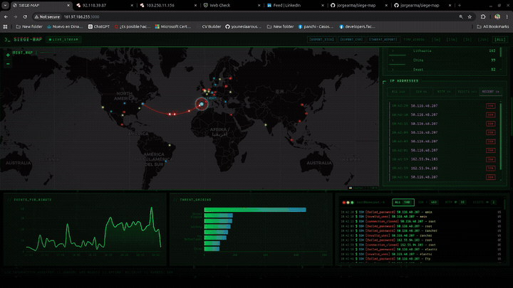
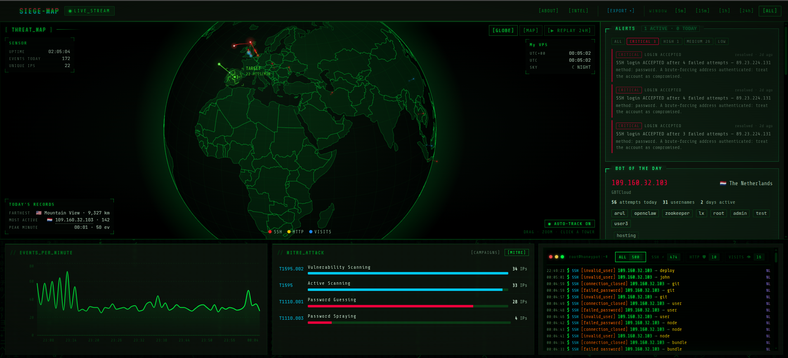
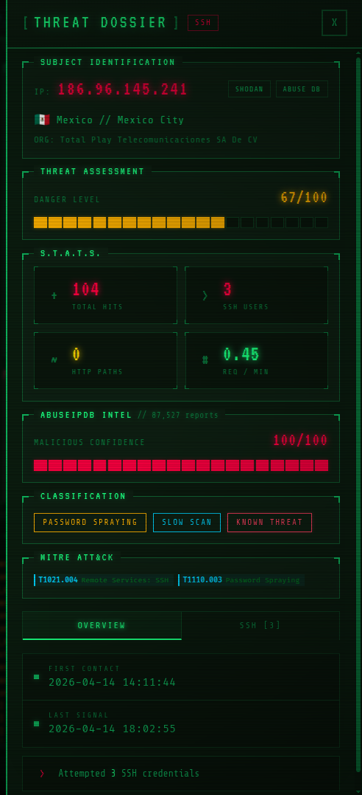
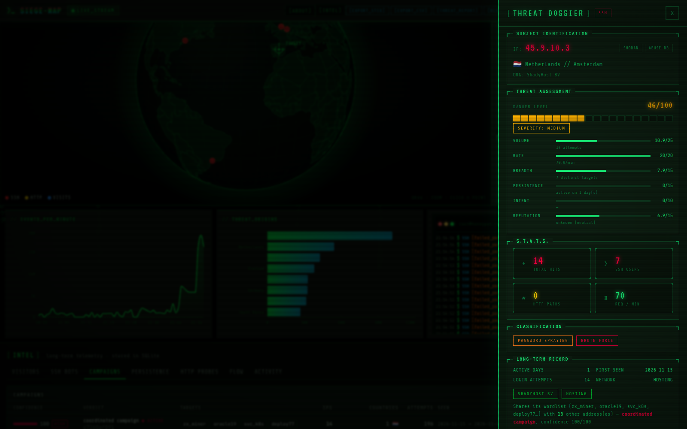
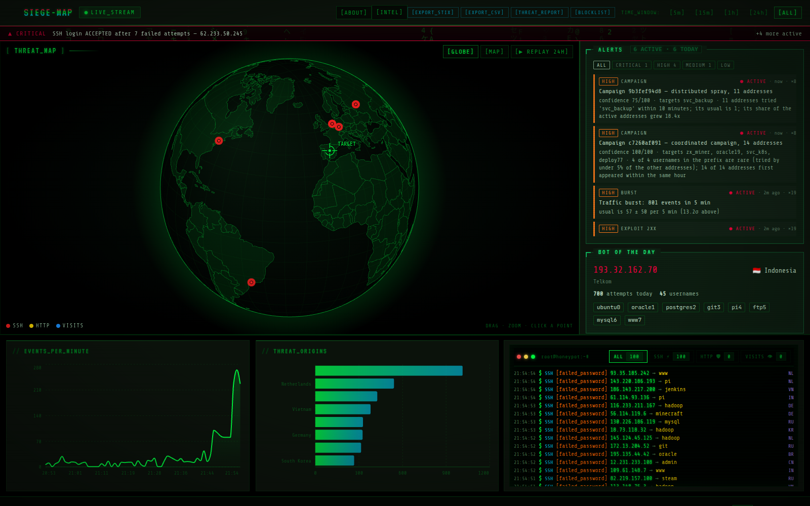
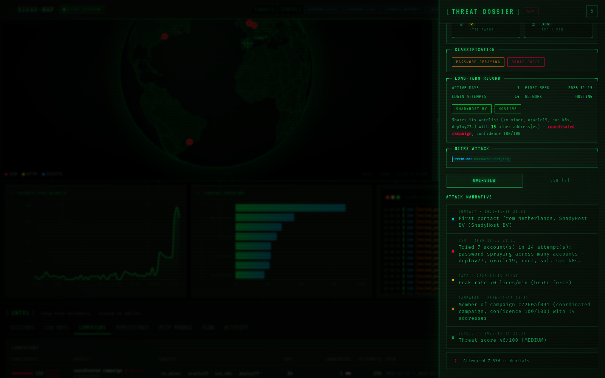

# siege map

**Visualizador de ataques SSH/HTTP en tiempo real .**
Lee logs de SSH y Nginx, geolocaliza las IPs, las clasifica con MITRE ATT&CK y las pinta en un mapa mundial con arcos animados, particulas de datos y un dashboard estilo terminal retro-futurista.

Pensado para correr en cualquier VPS con un solo `docker compose up`.



---

## Que hace exactamente

### En el mapa (panel principal)
- Mapa Leaflet oscuro con **arcos animados** desde el origen del ataque hasta tu VPS.
- **Particulas de datos** viajando por los arcos con fragmentos hex (`0xCAFE`, `SYN>>`, etc).
- **Reticula del VPS** con lineas de cruz, anillos rotativos y label `TARGET`.
- Cada IP atacante aparece como un **punto pulsante** del color de su tipo de ataque (rojo SSH, amarillo HTTP, azul visitas reales).
- Click en un punto -> **callout estilo espia** con linea de telemetria SVG animada, datos del subject (IP, origen, eventos, coordenadas) y boton `OPEN FULL DOSSIER` que abre el drawer completo.




### Sidebar (stats panel)
Todas las cards con tema Pip-Boy: bordes con corner brackets, headers flotantes, scanlines CRT, fuente VT323.
- **Total counter** con efecto de glitch ocasional (calavera ASCII y mensajes tipo `BREACH_DETECTED`).
- **Alerts**: alertas activas, historial y filtro por severidad (ver "Modelo de deteccion").
- **Attack patterns**: `PASSWORD_GUESSING`, `PASSWORD_SPRAYING`, `DICTIONARY_ATTACK`, `SSH_SCANNING`, `WEB_SCANNING`, `SINGLE_PROBE`.
- **Top origins** por pais con barras animadas.
- **IP addresses** con tabs (ALL / SSH / HTTP / VISITS / RECENT). Click en cualquier IP abre el drawer.
- **SSH targets**: nube de tags con todos los usernames probados en rojo.
- **HTTP routes**: separados en `BOTS` (probes a `/wp-admin`, `/.git`, etc) y `REAL` (rutas que tu app realmente sirve).
- **Recent events**: ultimos 10 hits con timestamp, IP y tipo.

### Drawer de perfil de atacante
Cuando clickeas una IP (en el mapa, en la lista o en el feed):
- Header `THREAT DOSSIER` con badge SSH/HTTP/SSH+HTTP.
- **Subject identification**: IP grande, geo, ASN/org, links a Shodan y AbuseIPDB.
- **Threat assessment** con `PipBoyMeter` segmentado, severidad y el **desglose del score** (de donde sale cada punto).
- **Vault stats**: cards con esquinas L para total hits, SSH users, HTTP paths, req/min.
- **AbuseIPDB intel** con porcentaje de confianza y total de reportes.
- **Classification**: pattern + speed + KNOWN_THREAT badge si es notorio.
- **MITRE ATT&CK** badges con TTPs identificados.
- Tabs OVERVIEW (**narrativa del ataque**: contacto, que probo, a que ritmo, campaña, alertas, veredicto), SSH (todos los usernames probados), HTTP (rutas con status code y conteo).



### Feed en vivo
Stream WebSocket con cada evento conforme entra: timestamp, IP, pais con flag, tipo, severidad. Filtros por SSH/HTTP/REAL.

### API REST + Export
- `GET /api/health` — health check.
- `GET /api/events?limit=` — eventos crudos.
- `GET /api/stats/{total,countries,ips,usernames,http-routes,patterns,asns,heatmap}?window=`.
- `GET /api/attacker/{ip}` — perfil completo.
- `GET /api/attackers?limit=&window=` — ranking por threat score.
- `GET /api/export/stix?window=` — bundle STIX 2.1 descargable.
- `GET /api/export/csv?window=` — eventos en CSV.
- `GET /api/export/report?window=` — resumen ejecutivo JSON.
- `GET /api/export/report.md?range=` — informe ejecutivo en Markdown desde el historico (SQLite).
- `GET /api/export/blocklist?days=&min_attempts=&format=txt|nft` — IPs SSH reincidentes para fail2ban / ipset / nftables.
- `GET /api/alerts?severity=&limit=` — alertas activas, historial y contadores del dia.
- `GET /api/intel/campaigns` — campañas con nivel de confianza y evidencia.

---

## Modelo de deteccion

Lo que separa esto de "un mapa bonito": cada etiqueta tiene una regla escrita, un test y una explicacion de por que no es un falso positivo. Las capturas de esta seccion usan los datos sinteticos de `scripts/demo_scenario.py`.

### 1. Patron de ataque y MITRE ATT&CK

sshd registra **que usuario** se probo, nunca la contraseña. Por eso el ataque se clasifica por su forma (cuantas cuentas, cuantos intentos por cuenta) y no se afirma nada que el log no permita ver.

| Patron | Forma | Tecnica |
|---|---|---|
| `PASSWORD_GUESSING` | pocas cuentas, muchos intentos cada una | T1110.001 |
| `PASSWORD_SPRAYING` | muchas cuentas (>=6), uno a tres intentos cada una | T1110.003 |
| `DICTIONARY_ATTACK` | muchas cuentas **y** muchos intentos cada una | T1110.001 |
| `SSH_SCANNING` | habla con sshd pero no prueba ningun usuario | T1595 |
| `WEB_SCANNING` | sondas HTTP; con firma de exploit conocida | T1595.002 (+T1190) |
| `SINGLE_PROBE` | una o dos lineas y desaparece | T1110 / T1595 |

No se usa T1110.004 (credential stuffing): sin la contraseña no se distingue de adivinar. Tampoco T1021.004, que es movimiento lateral con cuentas validas.

### 2. Threat score explicable (0-100)

85 puntos salen de lo que la IP **hizo aqui** y 15 de su reputacion publica. Si nadie ha consultado su reputacion se trata como neutra, asi que una IP nunca queda limitada por no tener dato de AbuseIPDB.

| Factor | Max | Que mide |
|---|---|---|
| volume | 25 | intentos (escala logaritmica, satura en 500) |
| rate | 20 | lineas por minuto (satura en 30) |
| breadth | 15 | cuentas o rutas distintas (satura en 50) |
| persistence | 15 | dias distintos en los que ha vuelto |
| intent | 10 | firma de exploit (+6), SSH y HTTP desde la misma red (+4) |
| reputation | 15 | confianza de AbuseIPDB |

Severidad: `LOW` <25, `MEDIUM` <50, `HIGH` <75, `CRITICAL` >=75. El drawer enseña el desglose completo.



### 3. Campañas con nivel de confianza

Dos IPs que prueban los mismos usuarios en el mismo orden comparten wordlist. Eso demuestra que usan la **misma herramienta**, no que las controle el mismo operador: la lista por defecto de un scanner popular la comparten miles de bots sin relacion. Llamar "campaña" a todo prefijo compartido es el falso positivo clasico.

Cada grupo es solo un candidato. Su confianza sale de tres señales independientes, medidas contra el resto del trafico:

- **specificity**: que raro es el prefijo. Para cada usuario, que parte de las IPs **de fuera** del grupo tambien lo prueban. `root, admin` no vale nada; un prefijo que nadie mas usa vale mucho.
- **timing**: llegan juntas? Parte del grupo cuyo primer contacto cae en su hora mas activa.
- **network**: comparten infraestructura? Parte del grupo que esta en un /24 con otro miembro (un rango alquilado pesa mas que "todas son de DigitalOcean").

Un grupo es `coordinated campaign` (HIGH) solo si **al menos dos señales coinciden**; una sola se queda en MEDIUM. Los grupos pequeños se amortiguan: dos IPs "llegando a la vez" es poca evidencia.

Segundo detector, para lo que el prefijo no ve: el **spray distribuido**, donde cada maquina prueba uno o dos usuarios. Señal: muchas IPs distintas contra el **mismo usuario** en diez minutos, muy por encima de lo habitual para ese usuario **y** con su cuota del trafico multiplicada (si todo sube a la vez es una rafaga, no un spray).


No se usa la version del cliente SSH: sshd no la registra con el `LogLevel` por defecto.

### 4. Alertas

| Regla | Dispara cuando | Severidad |
|---|---|---|
| `login_success` | una IP que estaba fallando logins consigue uno **aceptado** | CRITICAL |
| `exploit_2xx` | una ruta de exploit conocida recibe respuesta 2xx | HIGH |
| `high_score` | una IP activa alcanza el umbral de score | segun score |
| `campaign` | campaña activa de confianza MEDIUM/HIGH | segun campaña |
| `burst` | trafico de 5 min por encima de media + 3σ de las ultimas 24 h | MEDIUM/HIGH |
| `country_surge` | muchas IPs nuevas de un pais **y** su cuota del trafico se dobla | MEDIUM |
| `user_spray` | una IP prueba muchas cuentas en 10 min | MEDIUM |

Control de ruido:

- **Una alerta por (regla, sujeto)**. Mientras la condicion sigue, la alerta existente se actualiza (`hits`, `last_seen`); no se repite.
- **Cooldown**: se resuelve tras `ALERT_COOLDOWN` segundos de calma, y solo entonces el mismo sujeto puede volver a alertar.
- **Solo se reanuncia si sube de severidad.**
- **Umbrales relativos**: las reglas de volumen comparan con el historico del propio sensor, nunca con un "N eventos" fijo. Un servidor expuesto tiene un fondo permanente de bots.

Un login aceptado **nunca** se guarda ni se muestra (puede ser el dueño): solo cuenta si esa IP venia fallando, y el nombre de la cuenta va unicamente al webhook del operador.

Destinos: dashboard (panel, aviso en la cabecera y toast por WebSocket), y opcionalmente Discord, Slack, Telegram o cualquier webhook JSON (`ALERT_WEBHOOK_URL`).




### 5. Como se valida

`backend/tests/` (108 tests) incluye trafico sintetico con una botnet real escondida entre bots sin relacion: la botnet debe salir HIGH y la wordlist por defecto compartida debe salir LOW. Las reglas Sigma de `detections/` se validan en CI con `sigma check`.

```bash
cd backend && pip install -r requirements-dev.txt && python -m pytest -q
```

---

## Levantarlo en 30 segundos

```bash
git clone <este-repo>
cd ssh-bot-rain-map
cp .env.example .env
# Edita .env (ver "Adaptar a tu entorno" abajo)
docker compose up -d --build
```

Luego abre:
- Dashboard: `http://127.0.0.1:8082` (solo localhost; publícalo con un reverse proxy o Cloudflare Tunnel)
- API: `http://localhost:8000/api/health`

### Modo desarrollo (con logs sinteticos)
Si estas probando localmente y no tienes acceso a logs reales:

```bash
docker compose -f docker-compose.dev.yml up -d --build
# En otra terminal, genera trafico falso:
python scripts/fake_ssh_log.py --output ./logs/auth.log --rate 2.0
```

El compose dev monta `./logs/auth.log` en lugar de los logs del host.

### Demo guiada (5 minutos)

`scripts/demo_scenario.py` escribe un dia de ataque completo para que cada deteccion tenga algo que enseñar:

```bash
docker compose -f docker-compose.dev.yml up -d --build
python scripts/demo_scenario.py        # historico + parte en vivo
```

1. **Mapa y feed**: llegan los eventos en vivo.
2. **INTEL -> CAMPAIGNS**: la botnet (`zx_miner...`, un /24, 20 minutos) sale como `coordinated campaign`; la wordlist `root, admin, user, test` compartida por maquinas sin relacion sale como `shared tooling`. Click en la fila para ver la evidencia.
3. **Click en un miembro**: dossier con desglose del score y narrativa.
4. A los ~3 minutos el script lanza un pico de trafico y un login aceptado tras siete fallos: saltan `BURST` y `LOGIN ACCEPTED` (aviso en la cabecera + toast).
5. **[BLOCKLIST]** y `curl localhost:8000/api/export/report.md` para el informe.

Con `GEO_PROVIDER=ip-api` (45 consultas/min) las ~130 IPs tardan unos tres minutos en aparecer; con `mmdb` es inmediato.

---

## Adaptar a tu entorno

Todo lo que probablemente quieras tocar.

### 1. Variables de entorno (`.env`)

| Variable | Default | Que cambiar y por que |
|----------|---------|------------------------|
| `SSH_LOG_PATH` | `/var/log/auth.log` | **Obligatorio**. Debian/Ubuntu usa `auth.log`, RHEL/CentOS/Fedora usa `/var/log/secure`. |
| `NGINX_LOG_PATH` | `/var/log/nginx/access.log` | Opcional. Si no usas Nginx dejalo vacio o apunta a tu access log (Apache funciona si esta en formato combined). |
| `NGINX_LOG_PATHS` | _(vacio)_ | Varios access logs separados por coma (rutas **dentro** del contenedor). Si tiene valor, sustituye a `NGINX_LOG_PATH`. |
| `NGINX_LOG_DIR` | `/var/log/nginx` | Carpeta del **host** que se monta (solo lectura) como `/var/log/nginx` en el backend. Ver "Webs en contenedores" abajo. |
| `MASK_HTTP_IPS` | `true` | Trunca las IPs de visitantes HTTP a /24 (IPv4) o /48 (IPv6) antes de guardarlas. |
| `IGNORE_IPS` | _(vacio)_ | Tus IPs (casa, móvil), nunca aparecen en el mapa. |
| `TZ` | `UTC` | Zona horaria del **host**. Las lineas syslog clasicas no llevan offset: si el contenedor usa otro reloj, las ventanas de tiempo salen desplazadas. |
| `VPS_LAT` | `40.4168` | **Obligatorio**. Latitud de tu VPS — donde caera la "lluvia" de arcos. |
| `VPS_LON` | `-3.7038` | **Obligatorio**. Longitud de tu VPS. |
| `VPS_LABEL` | `My VPS` | Texto que veras en el popup del marker del VPS. |
| `GEO_PROVIDER` | `ip-api` | `ip-api` (gratis, 45 req/min) o `ipinfo` (mejor calidad, requiere token). |
| `IPINFO_TOKEN` | _(vacio)_ | Solo si `GEO_PROVIDER=ipinfo`. Token gratis en [ipinfo.io](https://ipinfo.io/). |
| `ABUSEIPDB_API_KEY` | _(vacio)_ | Opcional. Activa enriquecimiento de reputacion. Free tier: 1000 checks/dia. |
| `SHODAN_API_KEY` | _(vacio)_ | Opcional. Datos extra de puertos/OS/vulns. |
| `MAX_EVENTS` | `10000` | Eventos en memoria (cola circular). Sube si tienes mucho trafico y quieres ventanas largas. |
| `GEO_CACHE_TTL` | `86400` | TTL del cache de geo en segundos (24h por defecto). |
| `ABUSE_CACHE_TTL` | `86400` | TTL del cache de AbuseIPDB. |
| `WS_BROADCAST_INTERVAL` | `1.0` | Cadencia de envio por WebSocket en segundos. Sube a `2.0` si tu CPU sufre. |
| `ALERT_WEBHOOK_URL` | _(vacio)_ | Opcional. Webhook de Discord/Slack (se detectan) o cualquier URL que acepte JSON. Sin el, las alertas solo salen en el dashboard. |
| `ALERT_TELEGRAM_BOT_TOKEN` / `ALERT_TELEGRAM_CHAT_ID` | _(vacio)_ | Opcional. Alertas por Telegram. |
| `ALERT_NOTIFY_MIN_SEVERITY` | `HIGH` | Severidad minima que se envia fuera. |
| `ALERT_COOLDOWN` | `600` | Segundos de calma para resolver una alerta. El resto de umbrales (`ALERT_*`) estan comentados en `.env.example`. |
| `FRONTEND_PORT` | `8082` | Puerto del dashboard (en `127.0.0.1`). Cambialo si ya está en uso. |
| `BACKEND_PORT` | `8000` | Puerto del backend FastAPI. |

### 2. Rutas HTTP "legitimas" de tu app
**Importante** si tienes Nginx sirviendo una web propia. Por defecto cualquier ruta no listada se marca como `BOT_PROBE` (amarillo). Para que tus rutas reales aparezcan en azul como visitas legitimas:

Edita `frontend/src/config/knownRoutes.js` y añade tus rutas:

```js
export const KNOWN_ROUTES = [
  '/',
  '/about',
  '/api/...',
  // tus rutas aqui
]
```

### 2b. Webs en contenedores (p. ej. detrás de Cloudflare Tunnel)
En la imagen oficial `nginx` el `access.log` es un symlink a `/dev/stdout`: los logs solo existen en `docker logs` y el radar no tiene nada que leer. Para cada web:

1. **IP real del visitante** en el `nginx.conf` de la web (si no, todo llega desde el gateway de Docker `172.x` y el parser lo descarta):
   ```nginx
   set_real_ip_from 172.16.0.0/12;
   real_ip_header   CF-Connecting-IP;
   ```
   Solo es seguro si el puerto de la web está publicado en `127.0.0.1` (nadie de fuera puede inventarse la cabecera).
2. **Volumen** en el compose de la web, encima de `/var/log/nginx` (tapa los symlinks y nginx escribe un archivo real):
   ```yaml
   volumes:
     - /var/log/web/<sitio>:/var/log/nginx
   ```
3. **`.env` de siege-map**:
   ```bash
   NGINX_LOG_DIR=/var/log/web
   NGINX_LOG_PATHS=/var/log/nginx/<sitio>/access.log
   ```
4. **Rotación** en el host (`/etc/logrotate.d/web`). `copytruncate` porque nginx vive en el contenedor y no recibe la señal de reabrir; `tail -F` aguanta el truncado:
   ```
   /var/log/web/*/access.log {
       daily
       rotate 14
       compress
       delaycompress
       missingok
       notifempty
       copytruncate
   }
   ```

Si el backend no puede **leer** el log al arrancar (permisos), esa ingesta se para hasta reiniciar el backend: `docker logs ssh-rain-backend | grep -i permission`.

### 3. Coordenadas del VPS
Si no sabes la lat/lon de tu servidor, usa `curl ifconfig.co/json` desde el VPS o consulta el panel de tu proveedor (Hetzner, DigitalOcean, OVH, etc).

### 4. Frontend en host distinto al backend
Si despliegas frontend y backend en hosts separados (no recomendado para esta app, pero posible):
- Edita `frontend/src/hooks/useWebSocket.js` para apuntar al WS correcto (`ws://tu-backend:8000/ws`).
- Edita `frontend/vite.config.js` (`proxy.target`) para el modo dev.
- En produccion el `nginx.conf` del frontend asume backend en el servicio docker llamado `backend`. Cambialo si tu setup es distinto.

### 5. Si tu VPS ya usa los puertos 3000/8000
Cambia `FRONTEND_PORT` y `BACKEND_PORT` en `.env` o edita los port mappings en `docker-compose.yml`. Por ejemplo:

```yaml
frontend:
  ports:
    - "8080:80"   # accede en :8080
```

### 6. Permisos del log de SSH
El backend lee el log montado como read-only. En la mayoria de distros `auth.log` pertenece a `root:adm` o `root:syslog`. Si el contenedor no puede leerlo:

```bash
sudo chmod o+r /var/log/auth.log
# o ajusta el user del contenedor en docker-compose.yml
```

### 7. Personalizar la apariencia
- **Tema Pip-Boy**: las variables CSS estan al inicio de `frontend/src/styles/app.css` (`--pip-green`, `--pip-amber`, `--pip-bg`, etc). Cambialas para tener tu propia paleta.
- **Colores de tipos de ataque**: definidos en `frontend/src/components/WorldMap.jsx` (`SSH_COLOR`, `HTTP_COLOR`, `VISITOR_COLOR`).
- **Mensajes de glitch**: edita `GLITCH_LINES` en `frontend/src/components/StatsPanel.jsx`.

---

## Arquitectura

```
SSH/Nginx log --tail-F--> FastAPI ingesta
                              |
                              +--> parser (regex) --> SSHEvent / HttpEvent
                              |
                              +--> geo enrichment (ip-api / ipinfo, cached)
                              |
                              +--> threat intel (AbuseIPDB, opcional, cached)
                              |
                              +--> analyzer (patron + MITRE + score explicable)
                              |
                              +--> EventStore (deque en memoria, indice por IP)
                              |
                              +--> SQLite (agregados diarios, IPs, eventos recientes, alertas)
                              |
                              +--> campaigns (grupos con confianza) --+
                              |                                       v
                              +--> alerts (reglas, dedup, cooldown) --> webhook / Telegram
                              |
                              +--> WebSocket broadcast (1s) --> React UI
                              |
                              +--> REST API (stats, profile, export)
```

### Backend (`backend/app/`)
- `main.py` — FastAPI, dos tasks asincronas: `process_log_lines()` y `flush_loop()`.
- `tail.py` — `async for line in tail_log(path)`, sobrevive a logrotate.
- `parser.py` — regex SSH + HTTP (Nginx combined).
- `geo.py` — geolocalizacion con cache TTL.
- `threat_intel.py` — AbuseIPDB con rate limit (1 req/s, 900/dia).
- `analyzer.py` — patron de ataque, MITRE ATT&CK, score con desglose, heatmap 7x24.
- `campaigns.py` — campañas por wordlist y spray distribuido, con confianza y evidencia.
- `alerts.py` / `notify.py` — reglas, deduplicacion, cooldown, historial; envio a Discord/Slack/Telegram/webhook.
- `narrative.py` — historia de una IP en orden.
- `report.py` — informe ejecutivo en Markdown (`python -m app.report --days 30`).
- `db.py` — SQLite: agregados diarios, IPs, eventos recientes y alertas.
- `cache.py` — cache TTL acotada (las claves las controla el atacante).
- `stix_export.py` — bundle STIX 2.1 sin dependencia externa.
- `store.py` — `EventStore` con deque circular y dedupe por minuto.
- `models.py` — dataclasses `SSHEvent`, `HttpEvent`, `GeoInfo`.
- `config.py` — singleton `settings` que lee `.env`.

### Frontend (`frontend/src/`)
- `App.jsx` — root, gestiona estado de eventos y drawer.
- `components/WorldMap.jsx` — Leaflet + canvas particles + IntelCallout (spy card con linea SVG).
- `components/StatsPanel.jsx` — stats tipo Pip-Boy con tabs y nube de tags.
- `components/AttackerProfile.jsx` — drawer 440px con dossier completo.
- `components/EventFeed.jsx` — feed scrolleable en vivo.
- `components/Charts.jsx` — timeline Recharts.
- `components/HeatmapChart.jsx` — grid 7x24 (dia x hora).
- `components/ExportPanel.jsx` — botones STIX / CSV / REPORT.
- `components/MitreBadge.jsx` — badge reutilizable de TTP.
- `hooks/useWebSocket.js` — gestion de conexion WS.
- `config/knownRoutes.js` — whitelist de rutas legitimas.
- `styles/app.css` — todo el tema Pip-Boy + animaciones.

---

## Buenas practicas incorporadas

- `tail -F` con reintento automatico, sobrevive a `logrotate`.
- **Cache** y **rate limit** para geo (45 req/min) y AbuseIPDB (1 req/s, 900/dia).
- **Deduplicacion** ligera (`ip:user:type:minute`) para no inflar metricas.
- **Heuristica multi-factor** combinando velocidad (rpm), patron, diversidad de usernames y reputacion externa.
- Volumen del log montado **read-only** en el contenedor.
- SQLite en un volumen: agregados diarios para siempre, eventos individuales `EVENT_RETENTION_DAYS` dias.
- Caches **acotadas**: toda clave que controla un atacante (IP, usuario) tiene limite de tamaño.
- Entrada publica validada y salida escapada: ver [SECURITY.md](SECURITY.md).

---

## Operacion y troubleshooting

```bash
# Health check
curl http://localhost:8000/api/health

# Logs en vivo
docker compose logs -f backend
docker compose logs -f frontend

# Datos crudos
curl http://localhost:8000/api/events?limit=20
curl http://localhost:8000/api/stats/total

# Reset (sin perder logs del host)
docker compose restart backend

# Rebuild despues de tocar codigo
docker compose up -d --build
```

**Actualizar y volver atrás (imágenes etiquetadas con el commit):**
```bash
git pull
TAG=$(git rev-parse --short HEAD) docker compose up -d --build   # siege-map-*:<commit>

docker image ls 'siege-map-*'                                    # versiones disponibles
T=<commit-anterior>                                              # rollback, sin reconstruir:
docker image inspect siege-map-backend:$T siege-map-frontend:$T >/dev/null && TAG=$T docker compose up -d
# OJO: sin el "docker image inspect", un TAG que no existe NO da error: compose construye
# el código actual y le pone esa etiqueta (comprobado; pull_policy: never tampoco lo evita)

docker image rm siege-map-backend:<commit> siege-map-frontend:<commit>   # borrar versiones viejas
```

**No veo eventos:**
1. ¿El contenedor lee el log? `docker compose exec backend cat $SSH_LOG_PATH | head` (deberia funcionar).
2. ¿Hay actividad real? Genera con `python scripts/fake_ssh_log.py --output ./logs/auth.log --rate 2.0` en modo dev.
3. ¿Las coordenadas del VPS son correctas? Si estan a `0,0` el mapa centrara al medio del oceano.

**Geo dice "Unknown":**
- ip-api tiene rate limit. Espera o cambia a ipinfo con token.
- IPs privadas (`10.x`, `192.168.x`) no se geolocalizan a proposito.

**Frontend no conecta WS:**
- Mira la consola del navegador. Si hay `404` en `/ws`, revisa que el proxy de Vite o el `nginx.conf` apunten al backend correcto.

---

## Roadmap

- Multi-sensor: agregar varios VPS en un solo dashboard.
- Honeypot de interaccion media (Cowrie): contraseñas probadas y comandos tras el login.
- Reputacion por ASN a partir del historico propio.
- Modo claro (heretico pero por completitud).
- TLS/auth para exponer el dashboard publicamente.

---

## Licencia

MIT. Forkalo, adaptalo,.
